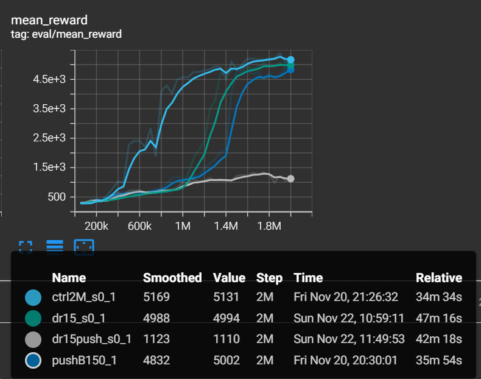

# Walker RL

Teaching a 2D biped (MuJoCo Walker2d) to walk with reinforcement learning.

## Before and after

| Random policy | PPO, 1M steps | PPO, normalization |
| --- | --- | --- |
|  |  |  |

First: an untrained robot falls in under a second.
Second: after 1 million steps of PPO it moves forward at about 2.4 m/s, but still falls after a few seconds.
Third: using PPO and observation/reward normalization, it moves at 4.1 m/s, and rarely falls.

Training with SAC (seed 0), it moves at 2,7 m/s.

## How to run

Tested with Python 3.13 on Windows.

    git clone https://github.com/moroczhanna13/walker-rl.git
    cd walker-rl
    python -m venv .venv
    .venv\Scripts\activate
    pip install -r requirements.txt

Evaluate and record a saved model:

    python evaluate.py --model models/pushB150_best/best_model --episodes 20
    python record_gif.py --model models/pushB150_best/best_model --camera track --out videos/demo.gif

Test robustness:

    python robustness_test.py --model models/pushB150_best/best_model --forces 0 100 150 200 --interval 50
    python physics_test.py --model models/dr15_s1_best/best_model --param friction --values 0.5 0.7 1.0 1.5

Train from scratch (about 27 minutes on 4 CPU cores):

    python train.py --normalize --n-envs 4 --timesteps 2000000 --push 150 --push-interval 50 --name my_push_run

## Roadmap

- [x] Environment setup, random-policy baseline
- [x] First PPO training
- [x] Tuned PPO
- [x] PPO vs SAC
- [x] Push robustness
- [x] Domain randomization

## Results

Mean return over 10 evaluation episodes (deterministic policy).

| Policy | Return | Episode length | Speed | Falls |
| --- | --- | --- | --- | --- |
| Random policy | 0.1 +/- 5.2 | 19 steps | - | 10/10 |
| PPO, default settings, 1M steps | 1465.6 +/- 200.4 | 446 steps | 2.29 m/s | 10/10 |
| PPO + observation/reward normalization | 4950.0 +/- 991.0 | 960 steps |  4.12 m/s | 1/10 |
| PPO + normalization + 4 parallel envs | 5566.5 +/- 13.3 | 1000 steps | 4.57 m/s | 0/10 |
| PPO + normalization + RL Zoo hyperparameters | 4277.8 +/- 196.8 | 991 steps | 3.30 m/s | 0/10 |

Normalizing observations and rewards was the single most important change:
it tripled the return and eliminated falls. Tuned hyperparameters from RL Zoo
did not beat the defaults in this single-seed run.

### PPO vs SAC

Best-model return over 20 evaluation episodes, mean ± std across 3 seeds.

| Algorithm | Training steps | Wall-clock per run | Return (3 seeds) | Per-seed returns |
| --- | --- | --- | --- | --- |
| PPO + normalization | 1M | ~23 min | 5164 +/- 423 | 4950 / 4787 / 5754 |
| SAC | 300k | ~79 min | 2571 +/- 932 | 3305 / 3151 / 1256 |

- **Sample efficiency:** at 300k steps SAC reached more return than PPO.
- **Wall-clock:** PPO finished 1M steps in a quarter of the time SAC needed for 300k.
- **Variance:** seed-to-seed spread is large for both algorithms.

Limitations: only 3 seeds per algorithm, and SAC was trained for fewer steps,
so this is not a claim about which algorithm is better in general.

## Robustness to pushes

How well does the learned gait survive random horizontal pushes to the torso?

| Before (trained without pushes) | After (trained with pushes) |
| --- | --- |
|  |  |

Red bar = a push is being applied (150 N for 0.04 s).

Fall rate over 20 episodes, pushes on average every 200 steps:

| Push force | Control (seed=0) | Control (seed=1) | Trained with pushes (seed=0) | Trained with pushes (seed=1) |
| --- | --- | --- | --- | --- |
| 0 N | 0/20 | 20/20 | 0/20 | 11/20 |
| 100 N | 3/20 | 20/20 | 6/20 | 12/20 |
| 150 N | 9/20 | 20/20 | 13/20 | 12/20 |
| 200 N | 12/20 | 20/20 | 16/20 | 12/20 |
| 400 N | 17/20 | 20/20 | 18/20 | 17/20 |

Both groups: PPO + normalization, 4 envs, 2M steps. The push-trained policies
saw 150 N pushes on average every 50 steps during training.

**What I learned**
- Training with pushes didn't make the robot more robust, it actually made it worse
- Training with different seeds is important, in a lot of cases one seed underperforms
- Maybe if I experiment with more seeds and different parameters, I can improve the robustness

Limitations: only one disturbance type was tested, and only 2 control seeds.

## Robustness to changed physics (domain randomization)

How sensitive is the policy to torso mass, ground friction and motor strength?
Falls out of 20 episodes:

| Test condition | Control | Domain randomization ±15% | Push-trained |
| --- | --- | --- | --- |
| Nominal | 0 | 0 | 0 |
| Friction × 0.85 | 0 | 5 | 0 |
| Friction × 0.7 | 0 | 20 | 2 |
| Torso mass × 1.25 | 1 | 5 | 20 |
| Motor strength × 0.9 | 3| 3 | 20 |
| Motor strength × 1.1 | 1 | 2 | 1 |

All policies: PPO + normalization, 4 envs, 2M steps, seed=0. Domain randomization
resamples torso mass, friction and motor gear uniformly within ±15% every episode.

Best-model return over 20 evaluation episodes

**What I learned**
- Training with domain randomization didn't improve robustness.
- I trained a model with the combination of domain randomization and pushes: it didn't even learn to walk (maybe the 2M steps were not enough and I only experimented with one seed)

Limitations: one seed and three randomized parameters only, simulation only.

## What I learned

- A single training run tells you very little, you have to run several seeds, paralel environments and a
  control group before believing a result.
- A high return does not mean a robust policy: a highest-scoring policy can be the most fragile one.
- Most of my time went into measuring and evaluating, not into training.

## Next steps

- Curriculum: start with weak pushes and increase the force during training.
- Combine pushes and domain randomization with a longer training budget.
- Move to GPU-based simulation (MuJoCo Playground) and a 3D robot.